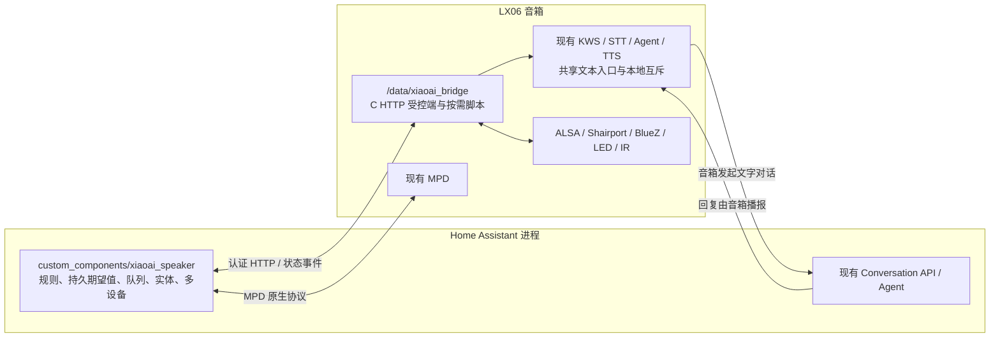

# XiaoAI Speaker Bridge

[](https://github.com/qiqi20020612/xiaoai-speaker-bridge/actions/workflows/ci.yml)

Home Assistant 2026.10 自定义集成，以及 LX06 `/data` 下的轻量受控端。统一原生媒体播放器、独立音量、智能跟随、主动播报、远程文字对话、监听管理和设备状态。KWS、STT、现有 Conversation Agent、五分钟上下文及原有 TTS 回退链继续由音箱已有脚本执行。

**用户已确认 v0.1.6 在 LX06 上通过语音、TTS、上下文、音量恢复、AirPlay 并发、任务取消/去重、重启、31 分钟空闲及 8 次播报压力测试。v0.1.7 的精简与原生任务灯效仍需真机复验，自动化不替代硬件验收。** 升级、回滚和最小复验见 [v0.1.7 功能与代码精简说明](docs/lx06-v017.md)。

**v0.2.1** 修复 AirPlay Duck 的恢复后置确认：Shairport 4.3.5 的 Remote 音量可能滞后，原逻辑会在 ALSA 写入和严格读回成功后仍保留 PENDING。正式安装包见 [v0.2.1 Release](https://github.com/qiqi20020612/xiaoai-speaker-bridge/releases/tag/v0.2.1)，源码证据、并发保护与待真机验收边界见 [恢复修复记录](docs/airplay-sender-recovery.md)。

本版保留 v0.2.0 的 HA 音量显示与 ALSA 整数刻度恢复、v0.1.9 的任务取消、文字提交清空及原生历史、播放前避让、原生物理静音键，以及 v0.1.8 的语音路径优化和元数据/封面支持。历史修复与验证边界见 [v0.2.0 记录](docs/lx06-v020.md)和 [v0.1.9 记录](docs/lx06-v019.md)；尚无 v0.1.7/v0.1.8 真机提速结论，见 [v0.1.8 测量与兼容性](docs/lx06-v018.md)。

## 两端架构



HA 集成直接运行于 HA 内。音箱仅有一个新增 C 常驻进程，硬件与语音脚本按需调用。无需部署 HA 外的服务端、容器或 Broker。媒体播放完全独立于 Linn / OpenHome；既有 Snapclient、upmpdcli 保留。

## 功能

| 入口 | 行为 |
|---|---|
| `media_player` | MPD 直连状态与控制；AirPlay 歌曲/歌手/专辑、时长/进度及安全封面代理；控制能力仍按真实后端逐项开放 |
| 独立 `number` | 仅主音量、播报音量、蓝牙三个滑块；显式音量服务仍支持耳机和已验证 AirPlay |
| 智能音量 | `auto` 使用唤醒前/文字请求前快照；明确对象优先；空闲固定 master；并发音源优先级继续在 HA 配置 |
| `announce` | 纯朗读，直接使用音箱原 TTS；不执行意图、不更新上下文 |
| `send_text` | HA → LX06 → 原本地意图/Agent → HA Conversation → LX06；使用原音箱 EOAIC2；支持共享/单次独立上下文、关闭回复播报 |
| 任务 | HA 内有界优先队列、去重、查询、取消、阶段状态、断线后按 ID 查询；不会盲目重发已经可能执行的文字 |
| 设备 | 总计 14 个实体；音源放在播放器属性中，AirPlay 百分比附加原始 dB，三个资源诊断；监听、刷新、重启 Bridge、重置会话 |
| AirPlay/蓝牙 | 真实服务检测和独立状态；反向控制需要逐项真机验证后开启本地 capability 标志 |
| 原生任务灯效 | 默认调用 LX06 原生 show_led / shut_led；语音优先、共享 LED 锁和 AirPlay Guard；不提供灯光实体或颜色 API |
| IR | 保留经过验证的有限脉冲能力接口，未验证时拒绝操作 |
| 开机 | 固定 `/data/xiaoai_boot.sh`，90 秒后仅停 Squeezelite，等待异步退出，启动桥接并确认就绪；Cron 幂等、可重试 |

AirPlay 音量具有只读传感器，原始 dB 保留在 API/诊断及已注册的兼容实体；没有通过发送端同步验证时，不会用主音量冒充反向控制。远程任务自动使用存在且可执行的原生灯效；程序不可用时安全跳过，语音优先。诊断实体的新默认策略保留旧 Entity ID 与用户启用选择。

AirPlay 歌曲信息复用现有 Shairport D-Bus GetAll 与 Probe，无需开启反向控制或新增配置；封面通过原生 HA media_player 代理按需取得，音箱不复制图片。字段缺失时安全降级，进度为发送端报告加本地时钟的估算，详见 [AirPlay 元数据、封面与验证边界](docs/airplay-metadata.md)。

v0.2.0 起，三个音量滑块与媒体播放器立即显示最新提交目标；失败恢复最近成功值，正常反馈错误。成功后等待可信的设备采样同步实际值，旧缓存、空值和语音/避让临时衰减不会覆盖目标。显示刷新不重发音量指令，音源路由和设备恢复保护沿用现有机制。

## 安装

先阅读 [逐端安装、启用、升级及回滚](docs/install.md)。固定契约为：

**0.1.1 修复 BusyBox 1.36.1 的 `flock` 兼容性，并增加安装失败自动恢复。** 0.1.0 若已更新 boot/Cron 后启动失败，请先按[部分安装恢复步骤](docs/install.md#8-从-010-的-busybox-启动失败状态恢复)使用新包回滚，再重新安装。

**0.1.2 显式接入原 EOAIC2 Agent、共享缓存及原令牌续期函数。** 真实 HTTP 回归核对 Agent/Conversation ID、401 续期和成功后的滑动期限，见 [Conversation 执行链路](docs/conversation.md)。用完整新包升级即可，现有 listener/Agent/KWS/STT/TTS 配置不替换。

**0.1.3 增加首次启动容错和诊断。** probe 超时提高到 15 秒，首次失败后分别等待 1、2 秒重试，启动健康等待预算为 75 秒。首次成功探测前保持未就绪；连续三次失败仍自动恢复安装事务。初始化、探测原因和安装恢复状态写入有界日志，见[启动诊断](docs/troubleshooting.md#首次启动与安装失败诊断)。

```text
HA:    config/custom_components/xiaoai_speaker/
LX06:  /data/xiaoai_bridge/start.sh
       /data/xiaoai_bridge/bin/xiaoai_bridge
       /data/xiaoai_bridge/config.json
       /data/xiaoai_boot.sh
Cron:  * * * * * /bin/sh /data/xiaoai_boot.sh
```

HACS 添加本仓库为 **Integration** 自定义仓库并安装，重启 HA，然后在“设置 → 设备与服务”添加 **XiaoAI Speaker Bridge**。填写音箱地址、桥接端口（默认 `8766`）、本地随机桥接令牌，以及 MPD 端口/可选密码。`8766` 与既有 KWS 服务端口分开。多台音箱分别添加，每台有独立设备 UUID、鉴权、音量存储和任务队列。

HACS 安装布局与本地 `brand/` 资源遵循 [HACS Integration 要求](https://www.hacs.xyz/docs/publish/integration/) 和 [HA 集成文件结构](https://developers.home-assistant.io/docs/creating_integration_file_structure/)。HACS 只安装 HA 端。安装包固定下载入口是 [GitHub Releases](https://github.com/qiqi20020612/xiaoai-speaker-bridge/releases)；尚未发版的构建可从 [CI](https://github.com/qiqi20020612/xiaoai-speaker-bridge/actions/workflows/ci.yml) 获取。仅声明已测 LX06/ARM EABI5 hard-float 兼容，音箱包须由用户审阅部署。

下载同一版本的 LX06 包、HA ZIP、`RELEASE_NOTES.md` 与 `SHA256SUMS` 到同一目录，执行 `sha256sum --check SHA256SUMS`（macOS：`shasum -a 256 --check SHA256SUMS`）。`v*` tag 经全部 CI 后才创建新 Release；手动发布也重新构建、严格校验，不能覆盖已有正式/预发布或草稿。维护者发版流程见[发布说明](docs/releases.md)。当前版本附件见 [v0.2.1 Release](https://github.com/qiqi20020612/xiaoai-speaker-bridge/releases/tag/v0.2.1)，回退基线附件见 [v0.2.0 Release](https://github.com/qiqi20020612/xiaoai-speaker-bridge/releases/tag/v0.2.0)；回退会重新带回 Remote 确认问题，设备部署需另行授权。

当前稳定 LX06 可从 **0.1.6 直接原地升级到 0.1.7**；保留 format=4 / hooks=4 / KWS guard=1 / AirPlay guard=3 的已审核私有副本，无需卸载、重新配对或修改旧 verified 字段。部署须在 PR 审阅和用户授权后进行，见 [v0.1.7 说明](docs/lx06-v017.md)。较早版本迁移记录见 [0.1.6](docs/lx06-v016.md) 和 [0.1.5](docs/lx06-v015.md)。

音箱安装器默认 `--dry-run`。原配置不会被通用模板替换；共享语音入口需要从本机实际 launcher 生成私有副本，并另行启用一行引导。安装自动启用已审核的原 AirPlay LED Guard，已有匹配 Guard 原样保留；缺少审核副本则预检拒绝，不加灯效开关。**不修改 Shairport 配置或软件音量曲线**，升级前状态纳入失败恢复。详情和移除方法见安装文档。

## 调用示例

设备页面提供两个原生文本操作控件：「播放文字」提交即调用 `announce`，「执行文字指令」提交即调用 `send_text`。v0.1.9 起，成功入队后自动清空，并通过原生 `logbook.log` 将完整原文记录到对应实体的活动中；提交失败不写 Logbook，并保留未入队的有效输入，任务结束后可再次提交相同文字。历史遵循用户现有 Recorder/Logbook 保留与过滤配置，不另建存储。`speak_response` 和 `use_context` 动作参数默认 true，快捷对话直接使用默认值，不创建配置开关。原文本实体 ID 保留，旧的两个发送按钮自动移除；任务状态、request_id 和错误码显示在文本实体属性中。**文本内容可能进入 HA 服务事件、自动化、日志及历史。** 输入前阅读[隐私与 Recorder 排除](docs/acceptance-fixes.md#文本输入隐私)。主动播报和有声远程文字回复默认自动避让 AirPlay：确认只有 AirPlay 活跃时，将高于 10% 的背景主音量降至 10%，结束后按现有 Journal 恢复；v0.1.9 将衰减移到合成完成后的实际解码器入口，合成期间音乐正常、原处理灯效持续，原生语音不变，适配范围与真机边界见 [v0.1.9 修复记录](docs/lx06-v019.md)。低音量、多音源或未知状态跳过衰减，无需额外开关或验证标记。任务灯效默认使用原生动画，不需要灯效配置；独立手动 RGB 灯环实体与接口已移除。

将实体 ID 换成实际设备的 ID。主动播报和对话是不同动作：

```yaml
action: xiaoai_speaker.announce
data:
  entity_id: media_player.your_speaker
  text: "客厅窗户还没关。"
  volume: 45
  priority: normal
  wait: true
```

```yaml
action: xiaoai_speaker.send_text
data:
  entity_id: media_player.your_speaker
  text: "打开客厅的灯，然后告诉我结果"
  speak_response: true
  use_context: true
  wait: true
```

```yaml
action: xiaoai_speaker.set_volume
data:
  entity_id: media_player.your_speaker
  target: auto
  level: 30
```

`target` 支持 `auto|master|tts|bluetooth|headphone|airplay|all`。无活动音源时固定 master，活动 AirPlay、蓝牙和 MPD 按原来源路由。`all` 在 AirPlay 活跃时排除主音量，且先检查所有目标能力。

MPD 示例、任务查询、自动化和可选 Dashboard 文字输入见 [examples/](examples/)。默认只向 Assist 暴露有需要的媒体播放器；将 TTS 音量、监听管理、重启桥接、重置按钮留在高级界面，避免泛化语音指令误操作。

## 安全和行为边界

使用随机桥接令牌、局域网和 IP 白名单；HTTP 本身不加密，应仅用于可信网络，禁止公网转发。音箱配置为 `0600`，不保存另一份 HA 长期令牌；现有 OAuth 与 Agent 配置仍由原脚本加载。支持的操作固定，文本不会当 Shell 执行。

优先级 `urgent` 只排在待执行任务前面，不打断原语音或正在执行的 Conversation。正常唤醒优先于桥接自己的播报，并在录音前保留音频锁。正在运行的对话不可取消，防止意图已经执行而错误宣称撤销；可取消排队任务和桥接自己启动的播报。HA 卸载会清理其任务/事件订阅，不会关闭音箱原语音服务。

详细限制、状态机、失败恢复、认证和边界值见 [协议与安全行为](docs/protocol.md)。

## 开发与验证

```sh
python3.14 -m venv .venv
.venv/bin/python -m pip install -r requirements-dev.txt
make -C speaker
make -C speaker check
.venv/bin/pytest
.venv/bin/ruff check .
.venv/bin/python tools/validate_metadata.py
.venv/bin/python tools/privacy_audit.py
```

CI 检查真实 HA 2026.10 测试框架、合成设备回归、C 编译/ASan/UBSan、ARM EABI5 静态构建、QEMU CLI、HACS、hassfest 和公开资料扫描。QEMU 与开发机测试不是 LX06 真机测试。

- [功能覆盖和责任矩阵](docs/coverage.md)
- [测试证据和待执行验收](docs/testing.md)
- [资源采样与验收报告模板](docs/resources.md)
- [故障排查](docs/troubleshooting.md)

公开仓库与通用产物不包含真机 IP/账号、配置快照、原语音脚本、私有生成副本、会话或资源采样。私人调查报告与审阅差异只在工作站 `.private/` 中保留。

参考：复用 [xiaoai-patch](https://github.com/duhow/xiaoai-patch) 既有链路，直接使用 [MPD 协议](https://mpd.readthedocs.io/en/stable/protocol.html)、[Shairport Sync](https://github.com/mikebrady/shairport-sync) 本机接口与 [HA Conversation API](https://developers.home-assistant.io/docs/intent_conversation_api/)。本仓库新代码采用 MIT；用户本机原脚本保留各自许可。
